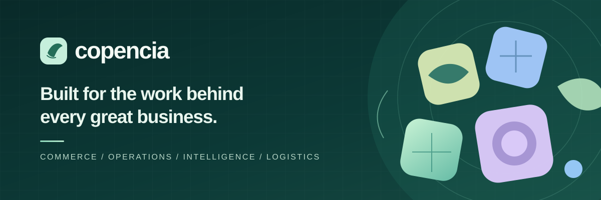

 

### The intelligent ERP for specialty businesses.

**Commerce, inventory, production, purchasing and fulfilment—on one connected platform.**

[**Explore Copencia**](https://copencia.com) &nbsp;·&nbsp; [**View our repositories**](https://github.com/orgs/copencia/repositories)

 

## Built for businesses that make, sell and deliver

The counter, the workbench, the stockroom and the delivery van all need to work together. Copencia brings the moving parts into one connected operating system for specialty businesses, starting with **floral retail** and designed for **bakeries, gifting and other production-driven teams**.

Our idea is simple: **every capability is a tile. Useful on its own, better when connected.**

 

## One workflow, connected end to end

**Commerce** &nbsp; → &nbsp; **Inventory** &nbsp; → &nbsp; **Production** &nbsp; → &nbsp; **Purchasing** &nbsp; → &nbsp; **Fulfilment**

From an order at the counter to a finished product at the door.

 

## One platform. Four pillars.

<table>
<tr>
<td width="50%" valign="top">

### 01 / Copencia Core

**The shared ERP foundation.**

A consistent foundation for business data, identity, locations, service boundaries and connected workflows.

</td>
<td width="50%" valign="top">

### 02 / Copencia Apps

**Software for the real world.**

Purpose-built experiences for the counter, workbench and shop floor—from WorkBench and handheld workflows to emerging POS, kiosk and production applications.

</td>
</tr>
<tr>
<td width="50%" valign="top">

### 03 / Copencia Intelligence

**It notices. It suggests. You approve.**

Our direction for insights, forecasting and AI-assisted decisions across orders, stock and production. Human approval stays in the loop for consequential actions.

</td>
<td width="50%" valign="top">

### 04 / Copencia Marketplace (planned)

**Add the next piece when you're ready.**

A future place for modules and integrations that connect to the capabilities a business already uses. **Not yet available.**

</td>
</tr>
</table>

 

## Made for real work

<table>
<tr>
<td width="33%" valign="top"><strong>WorkBench</strong>  Coordinate orders, messages and day-to-day operations with a clear view of what needs doing.</td>
<td width="33%" valign="top"><strong>Mobile workflows</strong>  Scan, receive, pick and complete work close to the products and people involved.</td>
<td width="33%" valign="top"><strong>Cloud + edge</strong>  Connect cloud services with local devices and existing shop systems without demanding a full replacement on day one.</td>
</tr>
</table>

 

## Built with intention

- **Modular by design.** Adopt capabilities individually; connect them as the business grows.
- **Secure foundations.** Tenant isolation, explicit authorization and deliberate service ownership.
- **Interoperable systems.** Connect to existing software and hardware while native capabilities evolve.
- **Practical intelligence.** Explore local and cloud inference for production insight, recipe analysis and operational recommendations—not AI for its own sake.

We're actively building. Some applications, integrations and intelligence capabilities described here are **in development**, not generally available. Public APIs, documentation and repositories will be shared as they're ready.

 

---

### Everything connected.

Start with the piece you need. Add the rest as you grow.

[**copencia.com**](https://copencia.com) &nbsp;·&nbsp; [**GitHub repositories**](https://github.com/orgs/copencia/repositories)

Copencia · The intelligent ERP for specialty businesses

